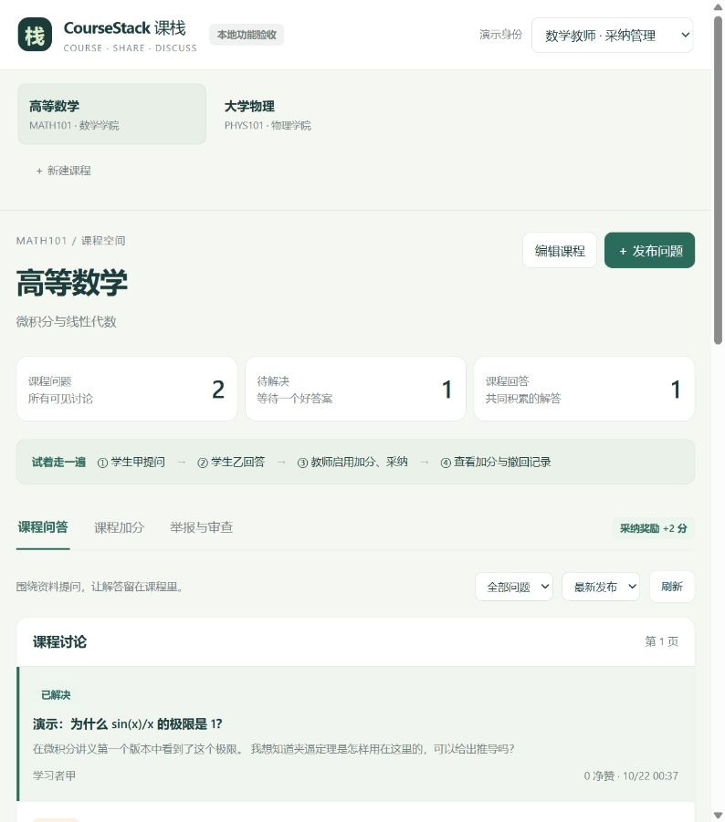

# 组员3首次提交：本地业务版本

2026-10-26，按组长“先提交”的要求，先提交现有本地成果供审阅。分支为 `3-course-discussion`，基线为 `7c29bbc`。这是草稿版本，尚未适配最新 `main`（检查时为 `318d8c5`），不能直接合并上线。

## 本次提交

- 课程信息、问答评论、固定版本关联、赞踩、采纳与加分、举报审查、下架恢复。
- 搜索/通知的业务事件与可见数据接口、个人空间查询。
- 独立本地联调契约、数据库迁移、幂等种子和45项定向测试。
- 仅在local与回环地址启用的可操作验收页，以及接口规范和联调文档。

本地验收采用真实workerd和D1；示例账号、课程及图片中的讨论均为虚构演示数据。测试与浏览器验收不代表已接入主站或通过线上联调。

## 合并前必须处理

1. 将最新main合入个人分支，保留组员1已经实现的账号、权限、数据库和管理员接口。当前 `backend/src/index.ts`、`src/db/schema.ts`、`package.json`、锁文件及文档存在同名文件，需要按模块合并，不能整份覆盖。
2. 将 `src/auth.ts` 的临时会话契约换成main的统一登录与权限服务，协调课程创建时的授课关系写入。
3. 将组员3数据需求归并到main的正式schema。`database/migrations/0001_shared_contract.sql` 仅用于独立本地验证，不是共享库的正式迁移。不能把这些迁移和main已有的身份迁移一起直接应用；需审核后追加正式增量，不能修改已应用迁移。
4. 对齐组员4的资料/版本状态、搜索和通知消费契约，以及组员2主站接口响应与页面流程。
5. 确认采纳奖励、学期归属、撤回与调整规则；当前实现选择已在联调说明中标记为提案。
6. 使用main的 `backend/wrangler.json` 和GitHub Actions部署工程。此分支的 `wrangler.jsonc` 仅提供独立local入口，不提供远程部署配置；不能与共享部署配置并存或覆盖后直接上线。
7. 完成适配、冲突处理和相关检查后，再将草稿PR标记为可审查，并由其他组员审查后合并。main合并会触发dev部署，远程D1迁移由CI应用。

## 本次不包含

Cloudflare/GitHub真实凭据、CSV私有配置、本地数据库、运行缓存、依赖目录或构建产物。只提交个人分支，不推送main，不运行云端迁移，不触发Worker部署。

后续适配继续更新同一分支与PR，避免将这次独立本地实现误认为已经集成完成。